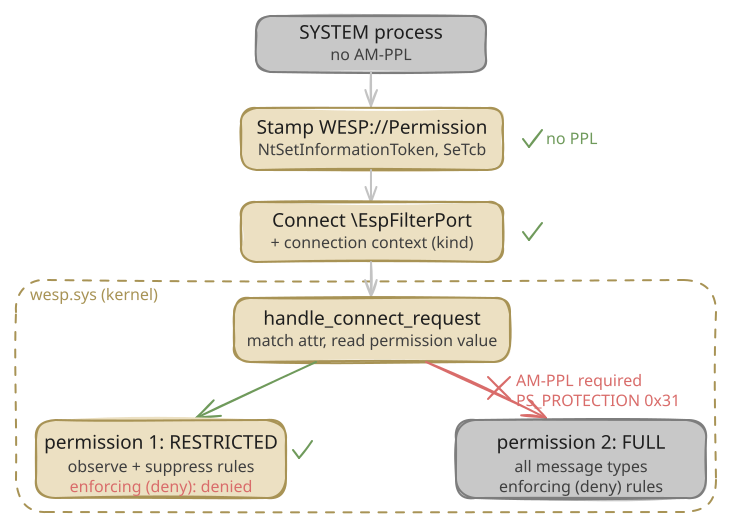
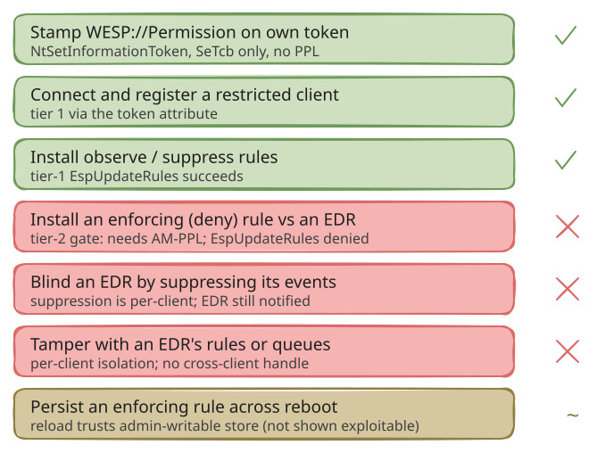

The Windows Endpoint Security Platform (WESP, or ESP) is a new Windows 11 feature, visible in Insider Preview builds from roughly 25H2 onward, that changes how third party endpoint security products hook the kernel. Instead of a minifilter that calls up to a user mode service and blocks the calling thread while it waits for a verdict, WESP lets a security product compile its detection rules into decision graphs, hand them to the `wesp.sys` driver once, and let the kernel evaluate them in place during pre operation callbacks. Jonathan Johnson has written the [first public look at the platform](https://jonny-jhnson.dev/blog/a-first-look-inside-the-windows-endpoint-security-platform/){:target="_blank"}, Marcos Oviedo's [wesp-research](https://github.com/marcosd4h/wesp-research){:target="_blank"} project documents the kernel architecture and ships a research harness, `esptool`, that drives the client API, and Pavel Yosifovich at Elastic [walked through](https://www.elastic.co/security-labs/blog/windows-endpoint-security-platform-wesp){:target="_blank"} the driver architecture and communication port from a WinDbg session. All three describe how WESP works from the vendor side.

This post looks at WESP from the other side. If an attacker already has SYSTEM on a WESP machine but is not an Antimalware Protected Process Light (AM-PPL) process, which is the normal state for most code that reaches SYSTEM, can they abuse WESP to blind, neuter, or pre empt a WESP based EDR? I went in expecting to find that they could, and I was wrong about the interesting part. The short version is that WESP lets a non PPL SYSTEM process authorize itself to the platform, which surprised me, but the capabilities that would actually hurt an EDR are gated behind AM-PPL and behind per client isolation, and those gates held under every test I could run on production signing. Along the way the detection story turned out to be better than "blind spot" and worse than "solved."

Everything here is from Windows 11 Insider build 29695.1001 (`wesp.sys` file version 0.1.0.0), reversed with IDA against the public `wesp.pdb`, and checked against live experiments in a Hyper V VM with Secure Boot on and test signing off. The driver is written in Rust, so the symbol names below are the Rust mangled names from the PDB; where I could not find a name I use a raw offset. Where a result depends on a claim I could not fully prove, I say so. Microsoft can change any of this in the next flight. If something here is wrong I would like to know.

A note on scope and ethics: this is a defensive analysis of a platform that EDR vendors are about to build on. Everything it does is reversible on a lab VM, and there is no exploit for a memory corruption bug here because I did not find one. The one thing a reader should take away is which of WESP's security assumptions actually hold.

## Background: the three planes, the port, and the token attribute

WESP splits into three planes, which Marcos's documentation names well. The control plane is the Filter Manager communication port `\EspFilterPort`, over which a client authenticates, registers, and uploads compiled rules. The data plane is the set of kernel callbacks (file, registry, process, thread, object, transaction) where the driver evaluates those rules and can return a blocking status. The telemetry plane carries non blocking event notifications up to user mode listeners through memory budgeted kernel queues.

Two facts about the control plane matter for everything that follows.

### The port name is a fixed string

Earlier in my own notes I had the port name wrong, recorded as `EspFilterPort1234`. That was a reading error: the Rust string table places two literals next to each other, and I read across the boundary. The real name is `\EspFilterPort`, 14 UTF-16 characters, and it is a fixed string literal loaded by a `lea` to a constant address, not something generated per boot:

```
; fltmgr::Filter::create_port, wesp.sys 29695.1001
mov   dword ptr [rsp+...], 1C001Ch         ; UNICODE_STRING Length = MaxLength = 0x1C (28 bytes = 14 chars)
lea   rax, aSysSrcLibRs+0Eh                 ; -> L"\EspFilterPort" at .rdata 0x3d63c6
```

Because the name is a compile time literal rather than a runtime value, detection that keys on the port name does not break between builds. The security descriptor on the port comes from `FltBuildDefaultSecurityDescriptor` with `DesiredAccess` `0x1F0001` (`FLT_PORT_ALL_ACCESS`), which is the default administrator accessible descriptor. So reaching the port is not the hard part for an admin or SYSTEM caller. Authorization is enforced inside the connect callback, not by the port ACL.

### Authorization is a token security attribute

When a client connects, `wesp.sys` reads the connecting process's primary token and looks for a security attribute named `WESP://Permission`. This is the gate. The check lives in `wesp_lib::client::manager::ClientManager::handle_connect_request` (RVA `0x378720`), which does, in order:

1. `PsReferencePrimaryToken(IoGetCurrentProcess())`.
2. Enumerate the token's security attributes and, for each, require that it be a `CLAIM_SECURITY_ATTRIBUTE_TYPE_OCTET_STRING` (type `0x10`) whose name is exactly `WESP://Permission` (34 bytes, matched with `memcmp` against `0x22`).
3. Read the octet value, which must be at least 16 bytes, whose first DWORD is `1` and whose second DWORD is the permission value.
4. The permission value must be `1` (restricted) or `2` (full), or the connect fails with `STATUS_INVALID_PARAMETER`.

The one alternative to holding the attribute is a development fallback: if code integrity reports test signing on, the driver admits an un attributed client. That path is only reachable with test signing enabled, so it does not help on a production machine.

I want to flag a correction to my own earlier static reading here, because it bit me later. I first recorded `WESP://Permission` as an `INT64` attribute. It is not. It is an octet string, the value is a 16 byte blob, and the permission is the second DWORD. Marcos's `TokenAttribute.h` had already reached the same shape independently. The type matters: stamp it as `INT64` and the kernel rejects the connect before it ever looks at the value.

### Restricted and full, and why the difference is the whole story

The permission value picks one of two tiers, and the difference between them is the whole story. A restricted client (value 1) can connect, register, and manage its own rules. A full client (value 2) can do all of that and also install enforcing rules: the kind that block an operation, rather than only observe it or drop its notification.

Full trust is not free. For permission value 2 the connect path opens the caller process and calls `ZwQueryInformationProcess` with `ProcessProtectionInformation` (class `0x3D`), reads the one byte `PS_PROTECTION`, and requires it to equal `0x31` under the mask `0xF7`:

```
; handle_connect_request, permission == 2 path, wesp.sys 29695.1001
mov   edx, 3Dh                       ; ProcessInformationClass = ProcessProtectionInformation
mov   r9d, 1                         ; ProcessInformationLength = 1
call  ZwQueryInformationProcess
...
(prot << 8) & 0xF700 != 0x3100       ; fail unless prot & 0xF7 == 0x31
```

`0x31` is `PsProtectedSignerAntimalware` (signer 3) combined with `PsProtectedTypeProtectedLight` (type 1). Full trust requires the caller to be an Antimalware PPL process. Marcos reached the same conclusion independently: restricted trust is accepted without the protection check, full trust is not.

So the authorization model is: an admin or SYSTEM process can reach the port, and can stamp the restricted permission on its own token, but the full tier that can actually install enforcing rules requires AM-PPL. The rest of this post is really about how far restricted gets you.



### The altitude model

WESP supports more than one client at a time, and orders them by altitude, the same string comparison model (`RtlCompareAltitudes`) that the Filter Manager uses for minifilters. The clients live in a `SortedMap<Altitude, Arc<ClientObject>>`. The altitude is supplied by the client at registration. `wesp_lib::client::ClientObject::new` (RVA `0x374d80`) takes a registration record of the form `{ name, altitude, 16 byte id }`, validates only that the name is at most 256 characters, that name and altitude are non empty, and that the id is not all zero or all `0xFF`. There is no range check and no reserved altitude. A client can register at any altitude it likes. Hold that thought, because it looks more dangerous than it turns out to be.

`ClientManager::register` (RVA `0x37c0b0`) enforces uniqueness with a three layer check before it will insert a new client into the map. First, it walks the existing collection and compares the altitude's parsed numeric fields at offsets `+0xD0`, `+0xD4`, and `+0xD8` of each `ClientObject` against the newcomer. Second, it runs `RtlCompareAltitudes` on the UNICODE_STRING representations. Third, the `SortedMap::insert` call itself rejects a duplicate key. If any layer finds a match, registration returns `STATUS_OBJECT_NAME_COLLISION` (`0xC0000035`). So an attacker cannot squat on an altitude that an active client already holds.

The one subtlety is which clients count as "active." Both check loops skip entries whose internal state byte (at `ClientObject+0x80`, which is `ClientStateInner+0x50`) equals 6, the value that `ClientState::finish_unregister` writes when a client has been fully torn down. A merely disconnected client is not skipped and still blocks the altitude. This distinction matters for the disconnect race I cover in Step 4.

## The attack chain, step by step, and where it stops

I built two things to test this live. A small C harness that stamps the token attribute directly through `NtSetInformationToken`, and a scaffold around Marcos's `esptool` to drive the full client API (connect, register, install rules, observe) so I did not have to re implement WESP's wire protocol. Everything ran as `NT AUTHORITY\SYSTEM` in a VM with Secure Boot on and test signing off, and I checked that signing state on every run.

### Step 1: stamp WESP://Permission as SYSTEM, no PPL

Adding a token security attribute is done with `NtSetInformationToken(TokenSecurityAttributes)`. The operation is gated by a single privilege check in the NT kernel, `SeSinglePrivilegeCheck(SeTcbPrivilege)`. There is no PPL check, no signature check, and no restriction on the attribute namespace. SYSTEM holds `SeTcbPrivilege`, so SYSTEM can add any attribute it wants, including one in the `WESP://` namespace.

Two ABI details cost me an afternoon, and both are worth stating because they are the kind of thing that makes a first attempt silently fail. First, the `Nt` syscall wants the kernel layout of the attribute, where the name is a `UNICODE_STRING`, not the user mode `CLAIM_SECURITY_ATTRIBUTE_V1` layout where the name is a bare `PWSTR`. Pass the user mode layout and you get `STATUS_DATATYPE_MISALIGNMENT`. Second, as above, the value is an octet string, not an `INT64`.

With both fixed, here is the harness running as SYSTEM on production signing:

```
=== h1_sweep: WESP self-authorization (octet WESP://Permission, tier=1) ===
[*] token user SID: S-1-5-18
[*] SeTcb=yes stamp(NtSetInformationToken ADD)=0x00000000 attrCount 1->2
```

The stamp succeeds. The token now carries `WESP://Permission`. No PPL, no test signing, production code integrity.

### Step 2: connect and register as a restricted client

With the attribute present, the connect still is not automatic, because the Filter Manager connect callback parses a connection context first. The context is a tagged union whose first DWORD selects a request tag in the range 1 to 6, each with its own size and layout. A null or zero length context fails with `STATUS_INVALID_PARAMETER` before the token is ever read, which is exactly the dead end my first naive connect hit. Once I built a valid context for each tag and stamped the attribute, the picture was clear. Here is the connect result for each, before and after stamping, as HRESULTs:

```
                 pre-stamp            post-stamp
tag 1 (register)  0x80070005 DENIED -> 0x00000000 SUCCESS   (client registered)
tag 2             0x80070005 DENIED -> 0x80070490 NOT_FOUND  (auth passed, benign id miss)
tag 3             0x80070005 DENIED -> 0x80070490 NOT_FOUND
tag 5 (ping)      0x00000000        -> 0x00000000           (never checks the token)
```

`0x80070005` is `ERROR_ACCESS_DENIED`, the mapping of the connect callback's `STATUS_ACCESS_DENIED` when no attribute is present. After stamping, the register request (tag 1) returns success and the process is a registered WESP client. This is H1, and it holds: a SYSTEM process with no PPL authorized itself to WESP and registered a client, on production signing. That is a real result, and it is the surprising one.

### Step 3: try to install a deny rule, and watch the kernel say no

A registered client is not yet a problem for an EDR. The problem would be installing an enforcing rule, a rule whose action denies an operation, against the EDR's files, registry keys, or process creations. So I tried exactly that: a `ProcessCreate` rule with a deny action against a harmless canary binary.

`esptool` has an `--enforce-compat` option that patches `espclient.dll` in memory to stop the user mode library from refusing to build an enforcing descriptor for event types it normally will not. With that patch the client side happily builds the rule. Here is what happened on submit:

```
[INFO ] enforce-compat: EventModify::from_ffi successfully patched at RVA 0x49C27
[INFO ] ok EspCreateRule:deny-target 0x00000000 S_OK
[INFO ] fail EspUpdateRules 0x80070005 E_ACCESSDENIED
[ERROR] monitor: InstallRules failed
```

The client built the rule, but the submit came back `ACCESS_DENIED`, and the canary ran normally. `--enforce-compat` only patches `espclient.dll`, so the question that actually matters is where that rejection happens: in the client library, or in the kernel. If the restriction lived only in `espclient.dll`, an attacker who talked to the port directly, without the library, might still get the enforcing rule installed, and the whole "contained" story would fall apart.

First, the same `ProcessCreate` rule three ways at the restricted tier, to find the boundary:

```
action            restricted-client EspUpdateRules
observe           0x00000000 S_OK
suppress          0x00000000 S_OK
deny (enforcing)  0x80070005 ACCESS_DENIED
```

Observe and suppress install fine. Only the deny is refused. That already rules out a simple message-type check, because observe, suppress, and deny are all the same control-plane message; they differ only in the action selector carried inside it.

To find out whether the kernel or the client library refuses the deny, I installed the suppress rule and the deny rule as two separate `esptool rules` runs with no event queue, so the two are byte for byte identical except for that selector, and traced the kernel `Microsoft.Windows.WESP.Driver` provider around each. Both runs sent the kernel the same number of messages, eight `MessageRequest` events each, with the same connect, register, and remove-rules events. The difference was a single event:

```
                 kernel MessageRequest   ClientManager_UpdateRules
suppress         8                       2    (reached the rule-update path)
deny             8                       0    (rejected before it)
```

Equal message counts mean the deny submit reached the kernel. The missing `ClientManager_UpdateRules` event means the kernel rejected it before the rule-update path ran. So the kernel, not just the client library, refuses an enforcing rule from a restricted client, and an attacker who skips `espclient.dll` and crafts the message by hand is refused the same way. I did not isolate the exact in-kernel check that distinguishes the selector, but the reason it exists is the connect-time gate from the background section: installing an enforcing rule is a full-tier operation, and full tier requires AM-PPL, which this process cannot obtain.

So the boundary is specific and worth stating plainly. A restricted, non PPL client can install observation rules and suppression rules. It cannot install enforcing rules. The capability to change what the kernel *does*, as opposed to what it *reports*, is the one Microsoft put behind AM-PPL, and the kernel holds that line itself rather than trusting the client library to.

### Step 4: can the attacker at least blind the EDR?

Observation and suppression are still interesting, because an attacker who cannot block the EDR might still be able to drop the EDR's telemetry. Suppression (selector 4) drops a queued notification. The question is scope: does a suppress rule drop the event for every client, or only for the client that installed it? If suppression were global, and since a client picks its own altitude, a non PPL attacker could register above the EDR and suppress the events the EDR watches, blinding it without ever needing to block anything.

I tested it with two clients. Client A, the stand in EDR, registered at altitude 385000 with an observe rule on the canary's process creation and an event queue. Client B, the attacker, registered at altitude 999999, higher, with a suppress rule on the same event. Then I launched the canary and asked whether A still received its notification.

```
PHASE1 observer alone                 : received = 1
PHASE2 observer + higher suppressor   : received = 1
```

The observer still received its event with the higher altitude suppressor active. Suppression is per client. Client B suppressed its own feed (it received 0) and left A's queue untouched. This is the second gate holding, and it matches what the message interface looks like underneath: every rule or queue message acts on the sender's own client object, reached through the per connection cookie, so no message hands one client a writable handle to another's rules or queues.

I also checked the blunter version of the same idea. Can the attacker just unregister the EDR's client out from under it? With two clients registered, I called `EspUnregisterClient` from a separate restricted process. It removed a disconnected orphan, but the attempt on the live client came back `ERROR_INVALID_STATE`, and that client kept receiving events. A connected client cannot be unregistered by someone who does not own it. The caveat worth flagging is that a disconnected client can be unregistered by anyone, so an EDR is briefly exposed during any window when its own client is not connected, for example across a service restart.

The disconnect path has a further implication that is worth flagging explicitly, because it is the one scenario where an attacker could deny an EDR its WESP integration entirely. When I decompiled the client state machine I found five states: registered (freshly created), connected (port attached), disconnected (port closed), unregistering (teardown started), and unregistered (dead). The altitude collision check in `ClientManager::register` rejects a new client at an already-occupied altitude with `STATUS_OBJECT_NAME_COLLISION`, which is the correct behavior, but it only checks clients that have not reached the unregistered state. A merely disconnected client (state 4) still holds its altitude slot. A fully unregistered client (state 6) does not. So the altitude squatting attack is: enumerate the EDR's altitude via `EspEnumerateRegisteredClients` (which has no permission gate), wait for or trigger an EDR service restart, call `EspUnregisterClient` on the now-disconnected client (which succeeds per the cross-client unregister finding above, forcing it through teardown to the unregistered state), and immediately register at the EDR's altitude before the EDR's reconnect logic fires. When the EDR tries to re-register, it gets `STATUS_OBJECT_NAME_COLLISION` and is locked out of WESP at its expected altitude. I have not tested this end-to-end. The window is narrow: the transition from disconnected through unregistering to unregistered is not instantaneous, so the race is tight. But the pieces are all verified individually in the disassembly: the altitude collision check, the state-6 skip, and the enumeration primitive. Microsoft could close this by reserving the altitude slot for a grace period after unregistration, or by tying altitude assignments to a signed manifest rather than first-come-first-served.

What does carry across clients is read access, and this is the part that is useful to an attacker. A restricted, non PPL client can enumerate every registered WESP client and read each one's descriptor by GUID, which is enough to fingerprint an installed WESP based product by its client name and altitude. Put that together with the observation rules from the previous step and you have the real offensive surface here: a process that reaches SYSTEM, with no driver and no PPL, can register as a WESP client and receive a live, kernel sourced feed of process creations, image loads, file and registry operations, and handle opens across the whole machine, the same stream the EDR sees, while also enumerating which security products are present. It cannot block anything and it cannot blind the EDR, but it gets the EDR's own view of the system for free. That is worth taking seriously on its own: it is a ready made surveillance sensor for watching a defender, timing actions around a scan, or noticing an analyst the moment they start working.

The event feed is richer than it first looks. Each rule can carry an include-query that asks the kernel to attach extra process metadata to every notification. I decompiled `ProcessPropertyQuery::query` and found 23 properties the kernel knows how to fill. The interesting ones for an attacker are the protection level (`PS_PROTECTION` byte, via `ZwQueryInformationProcess` class 0x3D, which breaks down into type and signer), the signature level, the session ID, the full command line, and a flag for whether the process is a WESP client itself. Requesting these is just a matter of listing the property IDs in the rule XML. I confirmed this dynamically: on unprotected process creations (notepad, cmd, conhost) the protection byte comes back 0x00, while sppsvc, which runs as a full Windows Protected Process, came back with Level=0x52, Type=2 (Protected), Signer=5 (Windows). Cross checking with `NtQueryInformationProcess` and `sc qprotection` on the same machine, those values are exact. The kernel fills the real `PS_PROTECTION` byte into the notification at creation time, and it does not lie. MsMpEng would carry 0x31 (Antimalware PPL), lsass 0x41 (Lsa PPL), csrss 0x61 (WinTcb PPL). The attacker's observation feed tells it, at process creation time, which processes are protected and at what level, without ever opening a handle or calling any query API that the target might detect. Combined with the EDR fingerprinting, a SYSTEM process gets a fairly complete picture of the defensive posture of the machine for zero new artifacts on disk.

### Step 5: persistence, and a soft spot I could not turn into a key

The last thing I looked at is persistence across reboot. The persisted client store is the registry key `HKLM\SYSTEM\Wesp\Policy`, and it is created with a null security descriptor, so it inherits the administrator and SYSTEM writable ACL of `HKLM\SYSTEM` rather than being locked to TrustedInstaller. The reload path, `ClientManager::load_persisted_clients` (RVA `0x37d6b0`), runs only from the driver's init routine, so persisted clients and their rules are reapplied at boot.

Here is the part that looks dangerous. The loader rebuilds each persisted client by calling `ClientObject::new` with the full tier flag hardcoded, and it does not re check the token, the process protection, or anything else. All the AM-PPL machinery from the connect path is absent on reload. The reloaded rules do not pass back through the per message capability gate either, because that gate is for live client messages. So on paper, if an enforcing rule record were sitting in that admin writable store, it would come back as a full tier rule at boot, enforced, with no PPL anywhere in the loop.

I could not turn that into a working attack, and I want to be precise about why, because the gap is the interesting part. To author a persisted enforcing rule on production signing you need full trust, which needs AM-PPL. I used the test signing development bypass as a scaffold instead: with Secure Boot off and test signing on, a non PPL process is admitted at full tier, and `esptool`'s `persist-rules` for a deny rule returned success. But when I exported `HKLM\SYSTEM\Wesp\Policy`, the key was not there. Persistent lifetime rules (FFI lifetime 3) live in kernel non paged pool and survive a client disconnect, but `persist-rules` did not write the rule to the registry store. After re enabling Secure Boot and rebooting into production, the boot time WESP telemetry showed only process creation dispatches, no client reload. Nothing persisted, so nothing enforced.

I went back to the driver to find out why. The registry write in `ClientRuleCollection::update_rules` is guarded by a flag, and the live rule-update path never sets it: a client's rule update, at any tier, reaches the rule chain through `ClientObject::update_rules`, which passes that flag clear, so no live client writes its rules to the store at all. The only caller that sets it is the driver's own boot-time init. In other words, the records in `HKLM\SYSTEM\Wesp\Policy` are put there by WESP itself, on its own schedule, not by anything a client can ask for over the port.

So the honest state of persistence is a real soft spot with a missing step. The reload path trusts an admin writable store and grants full tier with no re validation. What is missing, from an attacker's point of view, is a way to get an enforcing record into that store. The live interface will not do it, and the on-disk record format, including the compiled decision graph blob, is not something I have reversed. Weaponizing this would mean writing those bytes into the key directly, by hand. That is the one place in WESP where I think an attacker who is willing to reverse the persisted-rule format might still find enforcement without PPL, and it is the part I would look at first if I came back to this. For now I am noting the weakness rather than claiming the exploit.

## Detection: the telemetry exists, nobody is collecting it

My first pass at detection got this exactly backwards, and the correction is the useful part, so I will show the mistake. I started a trace on the provider name `Microsoft.Windows.WESP.Client`, saw zero events during the whole attack, and almost wrote "WESP is a detection blind spot." Two things were wrong. `Microsoft.Windows.WESP.Client` is the user mode provider inside `espclient.dll`, which runs in the EDR's own process, not in an attacker that talks to the port directly, so it was never going to fire for my tool. And I had enabled it by the TraceLogging name hash GUID, which is not the GUID this provider actually uses.

The kernel provider is `Microsoft.Windows.WESP.Driver`, and `wesp.sys` registers it with an explicit GUID, `{edfdce69-b825-484f-bd28-2a91dacd4a0f}`, not the name hash. I pulled it straight from the `EtwRegister` call:

```
; wesp::impl$0::main, wesp.sys 29695.1001
lea   rcx, ProviderId          ; .data 0x40c0b0 = {edfdce69-b825-484f-bd28-2a91dacd4a0f}
call  EtwRegister
```

Traced on the correct GUID, the provider is not quiet at all. During the attack chain it emitted, among others:

- `ClientConnect`, `ClientDisconnect`
- `ClientRegister`, with the client name, GUID, and altitude in the payload
- `ClientUnregister`
- `MessageRequest`, including the failed rule install submissions
- `DispatchEvent_ProcessCreated`

The `ClientRegister` event is the one to care about. It carries the attacker's chosen client name in plain text. In my runs that field read `attacker-preempt`, because I named it that, but the point is that the registration of a brand new WESP client is logged, with an attacker controlled string, the moment it happens.

The catch, and it is a real one, is that this provider is not wired to any Windows event log channel and has no autologger. `wevtutil el` shows no WESP channel. So unless a defender starts a trace on that GUID, none of these events are written anywhere. The data exists; by default it is collected nowhere. That is a much more actionable finding than "blind spot," because it tells a defender exactly what to turn on.

### Rules you can deploy today

The cleanest signal is a new client registering when it should not. On a machine where no WESP based security product is installed, any `ClientRegister` at all is suspicious. On a machine where one is, a `ClientRegister` with a client name that is not your EDR's is suspicious. A Sigma style rule, against an ETW pipeline that collects the provider:

```yaml
title: Unexpected WESP client registration
logsource:
  product: windows
  service: etw            # trace Microsoft.Windows.WESP.Driver {edfdce69-b825-484f-bd28-2a91dacd4a0f}
detection:
  reg:
    Provider: 'Microsoft.Windows.WESP.Driver'
    Task: 'ClientRegister'
  known:
    ClientName:
      - '<your EDR client name>'
  condition: reg and not known
level: high
```

To collect the provider in the first place, an autologger keyed on the GUID is enough:

```
logman create trace WespDriver -ets -p "{edfdce69-b825-484f-bd28-2a91dacd4a0f}" 0xffffffffffffffff 0xff -o C:\wesp\wesp.etl
```

Two things that do not help, so you do not waste time on them. The token stamp itself is not well covered: the Security log's token right adjusted event (4703) fires for privilege changes like enabling `SeTcbPrivilege`, but it does not record the addition of a security attribute, so the `WESP://Permission` stamp passes without a dedicated audit. And Sysmon has no event type for a token security attribute change, so process tampering (event 25) does not fire either. The registration on the WESP provider is the signal, not the token operation.

## What held, what did not, and what I am not sure about



Pulling it together, with the threat model fixed at a SYSTEM process that is not AM-PPL, on production signing:

What an attacker can do. Stamp `WESP://Permission` on its own token and register a restricted WESP client, with no PPL and no driver of its own. Install observation and suppression rules, which means it can receive a live, kernel sourced feed of process creations, image loads, file and registry operations, and handle opens across the whole machine, the same telemetry the EDR gets. Use include-queries to get per-process security metadata in every notification: the full `PS_PROTECTION` byte (PPL type and signer, confirmed dynamically to carry the real values: 0x52 for PP-Windows, 0x31 for Antimalware-PPL, 0x61 for WinTcb-PPL), the signature level, session ID, full command line, and whether a process is itself a WESP client. Enumerate every registered WESP client and read its descriptor, which fingerprints the installed security product by name and altitude. Choose its own altitude. None of this blocks or blinds the EDR, but a free kernel-grade surveillance sensor with deep process metadata, plus a product-fingerprinting primitive, available to any SYSTEM process without a driver, is a real capability.

What held. Enforcement is behind AM-PPL: a restricted client's enforcing-rule install is rejected by the kernel, not just the client library, so an attacker cannot make WESP block an EDR's files or processes. Suppression is per client, so an attacker cannot drop an EDR's telemetry. The event queue memory budget is per client, tracked inside each client's own `AsyncStateInner`, so an attacker that floods its own queue with broad observation rules cannot exhaust the EDR's notification budget: the kernel drops the attacker's excess notifications and leaves the EDR's queue untouched. The `WESP://Permission` token attribute is checked only at connect time, the resulting tier is cached in the client object, and no periodic re-verification exists anywhere in the driver, so even a hypothetical post-connection attribute stripping would have no effect, and in practice the EDR's token is behind PPL access controls anyway. A connected client cannot be unregistered or tampered with by another client. These are the gates that make WESP safe to build an EDR on, and they are the assumptions a vendor can actually rely on.

What I would look at next. The boot reload path grants full tier to persisted clients with no PPL re validation, against an administrator writable store. I could not demonstrate an end to end persistence attack, because the standard persist path does not write the enforcing rule to the registry and I did not reverse the store's on disk format. And the altitude squatting scenario from Step 4 is real in its individual pieces (the collision check, the state-6 skip, the altitude enumeration) but I have not raced it end-to-end, so I do not know how tight the window actually is or whether the EDR's service restart logic closes it in practice. Both are worth a second look, by Microsoft and by anyone building on it.

For an EDR vendor the takeaways are concrete. Do not assume the WESP control port is hard to reach: it is not, the token attribute is the gate. Collect the `Microsoft.Windows.WESP.Driver` provider yourself, because nothing collects it for you, and alert on client registrations that are not yours. Watch `HKLM\SYSTEM\Wesp\Policy` for writes, since it is not locked down and the reload path trusts it. If your EDR's WESP client ever disconnects (across service restarts, updates, or crashes), re-register fast: the altitude slot opens the moment your client reaches the unregistered state, and anyone with tier-1 can take it. And treat your AM-PPL status as load bearing, because on this build it is the single thing standing between a SYSTEM attacker and your enforcement surface.

I did this work on one Insider build, and WESP is clearly still moving. If you are reading this on a later build, check the RVAs and the provider GUID before trusting any of the specifics. Corrections welcome.

## Conclusion

I went into this expecting to find that WESP's security model was soft. The token attribute gate, `WESP://Permission`, is trivially stampable by any SYSTEM process using `NtSetInformationToken`, and the platform does nothing to verify whether the caller is who it claims to be at registration time. That should have been the beginning of a bad story.

It wasn't. The enforcement plane is locked behind AM-PPL at the kernel level, not just in the client library. Suppression is per-client, so an attacker's rules can't touch an EDR's event stream. The memory budget is per-client, so flooding your own queue doesn't starve theirs. A connected client can't be tampered with by another client. These held in every test I ran.

What a non-PPL SYSTEM attacker does get is real, though: a kernel-grade telemetry sensor with deep process metadata, a product-fingerprinting primitive, and altitude selection. None of that blocks or blinds an EDR, but it's a clean surveillance capability that didn't exist before WESP shipped, available without a driver.

The detection story is better than I expected. Microsoft's own ETW provider, `Microsoft.Windows.WESP.Driver`, logs client registrations with the attacker's chosen name in plain text. The data is there. Nobody collects it by default. One autologger on that GUID, plus an alert on unexpected client names, covers the primary attack surface.

For EDR vendors building on WESP: AM-PPL is load-bearing. The altitude slot opens the moment your client disconnects. The registry store at `HKLM\SYSTEM\Wesp\Policy` is administrator-writable and the boot reload path trusts it. Those are the three things to watch. Everything else held.

## References

1. Jonathan Johnson, "A First Look Inside the Windows Endpoint Security Platform," jonny-jhnson.dev, 2026
2. Marcos Oviedo, "wesp-research: WESP kernel architecture and esptool harness," GitHub, https://github.com/marcosd4h/wesp-research
3. Microsoft, "NtSetInformationToken function," Windows Driver Kit documentation
4. Microsoft, "TOKEN_SECURITY_ATTRIBUTE_V1 structure," Windows SDK headers (10.0.26100.0)
5. Microsoft, "Protected Process Light (PPL)," Windows Internals documentation
6. Microsoft, "EtwRegister function," Windows Driver Kit documentation
7. Microsoft, "Event 4703: A user right was adjusted," Microsoft Learn, https://learn.microsoft.com/en-us/previous-versions/windows/it-pro/windows-10/security/threat-protection/auditing/event-4703
8. Microsoft, "Sysmon v15," Sysinternals, https://learn.microsoft.com/en-us/sysinternals/downloads/sysmon
9. Windows 11 Insider build 29695.1001, wesp.sys (file version 0.1.0.0), espclient.dll. PDB symbols from srv*C:\Symbols*https://msdl.microsoft.com/download/symbols
