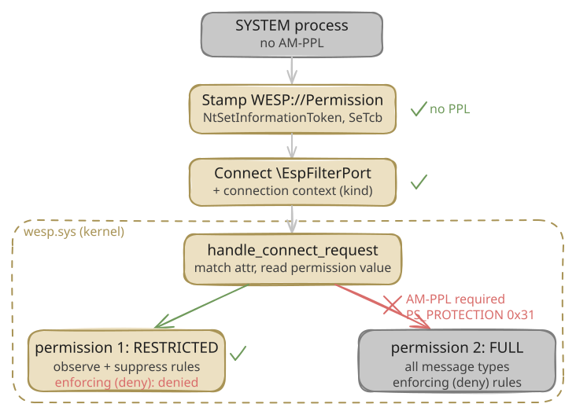

The Windows Endpoint Security Platform (WESP, or ESP) changes how third-party endpoint security products hook the kernel. Instead of a minifilter that calls up to a user-mode service and blocks the calling thread while it waits for a verdict, a security product can compile its rules into decision graphs, hand them to `wesp.sys`, and let the kernel evaluate them in place during pre-operation callbacks.

Jonathan Johnson wrote the [first public look at the platform](https://jonny-jhnson.dev/blog/a-first-look-inside-the-windows-endpoint-security-platform/){:target="_blank"}. Marcos Oviedo's [wesp-research](https://github.com/marcosd4h/wesp-research){:target="_blank"} documents the kernel architecture and ships `esptool`, a harness for driving the client API. Pavel Yosifovich at Elastic [walked through](https://www.elastic.co/security-labs/blog/windows-endpoint-security-platform-wesp){:target="_blank"} the driver and communication port from a WinDbg session. Their work explains WESP from the vendor side. Reading it left me with a different question: what can an attacker who already has SYSTEM, but not Antimalware Protected Process Light (AM-PPL), do with the same interface?

I expected the trust split to make the answer simple: restricted clients get telemetry, AM-PPL clients get enforcement. It was not quite that clean. A non-PPL SYSTEM process could authorize itself, register a client, and install observation or suppression rules. My `ProcessCreate` deny update returned `ACCESS_DENIED`, and a higher-altitude suppressor did not remove another client's notification. Those results are useful, but they do not prove that every enforcing rule is AM-PPL-only or that every cross-client denial-of-service path is closed.

I used IDA 9.4 with the public `wesp.pdb` and tested the results in an isolated Hyper-V VM with Secure Boot on and test-signing mode off. The driver is written in Rust, so the function names below come from the PDB; where there was no useful name, I use a raw RVA. When something comes only from static analysis, I say so. The exact binaries and hashes are in the references.

There is no memory-corruption exploit here because I did not find a memory-corruption bug. The interesting part is what the supported client interface already gives SYSTEM without PPL, and where that access stops.

## The three planes

WESP splits into three planes, which Marcos's documentation names well. The control plane is the Filter Manager communication port `\EspFilterPort`, over which a client authenticates, registers, and uploads compiled rules. The data plane is the set of kernel callbacks (file, registry, process, thread, object, transaction) where the driver evaluates those rules and can return a blocking status. The telemetry plane carries non-blocking event notifications to user-mode listeners through memory-budgeted kernel queues.

Two facts about the control plane matter for everything that follows.

### The port name is a fixed string

Earlier in my own notes I had the port name wrong, recorded as `EspFilterPort1234`. That was a reading error: the Rust string table places two literals next to each other, and I read across the boundary. The real name is `\EspFilterPort`, 14 UTF-16 characters, and it is a fixed string literal loaded by a `lea` to a constant address, not something generated per boot:

```
; fltmgr::Filter::create_port, wesp.sys 29695.1001
mov   dword ptr [rsp+...], 1C001Ch         ; UNICODE_STRING Length = MaxLength = 0x1C (28 bytes = 14 chars)
lea   rax, aSysSrcLibRs+0Eh                 ; -> L"\EspFilterPort" at .rdata 0x3d63c6
```

Because the name is a compile-time literal rather than a runtime value, it is stable within this image. That does not guarantee that Microsoft will keep it across builds. The security descriptor on the port comes from `FltBuildDefaultSecurityDescriptor` with `DesiredAccess` `0x1F0001` (`FLT_PORT_ALL_ACCESS`), which is the default administrator-accessible descriptor. With that descriptor, an elevated administrator or SYSTEM caller can reach the port; authorization happens inside the connect callback, not in the port ACL.

### Authorization is a token security attribute

When a client connects, `wesp.sys` reads the connecting process's primary token and looks for a security attribute named `WESP://Permission`. This is the gate. The check lives in `wesp_lib::client::manager::ClientManager::handle_connect_request` (RVA `0x378720`), which does, in order:

1. `PsReferencePrimaryToken(IoGetCurrentProcess())`.
2. Enumerate the token's security attributes and, for each, require that it be a `CLAIM_SECURITY_ATTRIBUTE_TYPE_OCTET_STRING` (type `0x10`) whose name is exactly `WESP://Permission` (34 bytes, matched with `memcmp` against `0x22`).
3. Read the octet value, which must be at least 16 bytes, whose first DWORD is `1` and whose second DWORD is the permission value.
4. The permission value must be `1` (restricted) or `2` (full), or the connect fails with `STATUS_INVALID_PARAMETER`.

The one alternative to holding the attribute is a development fallback: if code integrity reports test-signing mode on, the driver admits an unattributed client. That path is only reachable with test-signing mode enabled, so it does not help on a production machine.

I want to flag a correction to my own earlier static reading here, because it bit me later. I first recorded `WESP://Permission` as an `INT64` attribute. It is not. It is an octet string, the value is a 16-byte blob, and the permission is the second DWORD. Marcos's `TokenAttribute.h` had already reached the same shape independently. The type matters: stamp it as `INT64` and the kernel rejects the connect before it ever looks at the value.

### Restricted and full

The permission value picks one of two tiers. A restricted client (value 1) can connect, register, and manage its own rules. A full client (value 2) can do all of that and also install enforcing rules: the kind that block an operation, rather than only observe it or drop its notification.

For permission value 2, the connect path opens the caller process and calls `ZwQueryInformationProcess` with `ProcessProtectionInformation` (class `0x3D`), reads the one-byte `PS_PROTECTION`, and requires it to equal `0x31` under the mask `0xF7`:

```
; handle_connect_request, permission == 2 path, wesp.sys 29695.1001
mov   edx, 3Dh                       ; ProcessInformationClass = ProcessProtectionInformation
mov   r9d, 1                         ; ProcessInformationLength = 1
call  ZwQueryInformationProcess
...
(prot << 8) & 0xF700 != 0x3100       ; fail unless prot & 0xF7 == 0x31
```

`0x31` is `PsProtectedSignerAntimalware` (signer 3) combined with `PsProtectedTypeProtectedLight` (type 1). Full trust requires the caller to be an Antimalware PPL process. Marcos reached the same conclusion independently: restricted trust is accepted without the protection check, full trust is not.

So the authorization model is: an elevated administrator or SYSTEM process can reach the port, but stamping the attribute requires `SeTcbPrivilege`. An elevated administrator does not necessarily hold that privilege; the SYSTEM token used in my harness did. The full-tier connect path separately requires AM-PPL. The rest of this post is about how far the restricted tier got in my tests.



### The altitude model

WESP supports more than one client at a time, and orders them by altitude, the same string comparison model (`RtlCompareAltitudes`) that the Filter Manager uses for minifilters. The clients live in a `SortedMap<Altitude, Arc<ClientObject>>`. The altitude is supplied by the client at registration. `wesp_lib::client::ClientObject::new` (RVA `0x374d80`) takes a registration record of the form `{ name, altitude, 16-byte ID }`, validates only that the name is at most 256 characters, that name and altitude are nonempty, and that the ID is not all zero or all `0xFF`. There is no range check and no reserved altitude. A client can register at any altitude it likes. Hold that thought, because it looks more dangerous than it turns out to be.

`ClientManager::register` (RVA `0x37c0b0`) enforces uniqueness with a three-layer check before it will insert a new client into the map. First, it walks the existing collection and compares the altitude's parsed numeric fields at offsets `+0xD0`, `+0xD4`, and `+0xD8` of each `ClientObject` against the newcomer. Second, it runs `RtlCompareAltitudes` on the UNICODE_STRING representations. Third, the `SortedMap::insert` call itself rejects a duplicate key. If any layer finds a match, registration returns `STATUS_OBJECT_NAME_COLLISION` (`0xC0000035`). So an attacker cannot squat on an altitude that an active client already holds.

The one subtlety is which clients count as "active." Both check loops skip entries whose internal state byte (at `ClientObject+0x80`, which is `ClientStateInner+0x50`) equals 6, the value that `ClientState::finish_unregister` writes when a client has been fully torn down. A merely disconnected client is not skipped and still blocks the altitude. This distinction matters for the disconnect race I cover in Step 4.

## The attack chain, step by step, and where it stops

I built two things to test this live. A small C harness that stamps the token attribute directly through `NtSetInformationToken`, and a scaffold around Marcos's `esptool` to drive the full client API (connect, register, install rules, observe) so I did not have to reimplement WESP's wire protocol. Everything ran as `NT AUTHORITY\SYSTEM` in a VM with Secure Boot on and test-signing mode off, and I checked that signing state on every run.

### Step 1: stamp WESP://Permission as SYSTEM, no PPL

Adding a token security attribute is done with `NtSetInformationToken(TokenSecurityAttributes)`. The operation is gated by a single privilege check in the NT kernel, `SeSinglePrivilegeCheck(SeTcbPrivilege)`. There is no PPL check, no signature check, and no restriction on the attribute namespace. SYSTEM holds `SeTcbPrivilege`, so SYSTEM can add any attribute it wants, including one in the `WESP://` namespace.

Two ABI details cost me an afternoon, and both are worth stating because they are the kind of thing that makes a first attempt silently fail. First, the `Nt` syscall wants the kernel layout of the attribute, where the name is a `UNICODE_STRING`, not the user-mode `CLAIM_SECURITY_ATTRIBUTE_V1` layout where the name is a bare `PWSTR`. Pass the user-mode layout and you get `STATUS_DATATYPE_MISALIGNMENT`. Second, as above, the value is an octet string, not an `INT64`.

With both fixed, here is the harness running as SYSTEM on production signing:

```
=== h1_sweep: WESP self-authorization (octet WESP://Permission, tier=1) ===
[*] token user SID: S-1-5-18
[*] SeTcb=yes stamp(NtSetInformationToken ADD)=0x00000000 attrCount 1->2
```

The stamp succeeds. The token now carries `WESP://Permission`. No PPL, no test-signing mode, production code integrity.

### Step 2: connect and register as a restricted client

With the attribute present, the connect still is not automatic, because the Filter Manager connect callback parses a connection context first. The context is a tagged union whose first DWORD selects a request tag in the range 1 to 6, each with its own size and layout. A null or zero-length context fails with `STATUS_INVALID_PARAMETER` before the token is ever read, which is exactly the dead end my first naive connect hit. Once I built a valid context for each tag and stamped the attribute, the picture was clear. Here is the connect result for each, before and after stamping, as HRESULTs:

```
                 pre-stamp            post-stamp
tag 1 (register)  0x80070005 DENIED -> 0x00000000 SUCCESS   (client registered)
tag 2             0x80070005 DENIED -> 0x80070490 NOT_FOUND  (auth passed, benign id miss)
tag 3             0x80070005 DENIED -> 0x80070490 NOT_FOUND
tag 5 (ping)      0x00000000        -> 0x00000000           (never checks the token)
```

`0x80070005` is `ERROR_ACCESS_DENIED`, the mapping of the connect callback's `STATUS_ACCESS_DENIED` when no attribute is present. After stamping, the register request (tag 1) returns success and the process is a registered WESP client. That answered the first question: with Secure Boot on and test-signing mode off, a SYSTEM process with no PPL authorized itself to WESP and registered a client. I had expected the trust boundary to appear earlier.

### Step 3: try to install a deny rule

A registered client is not yet a problem for an EDR. The problem would be installing an enforcing rule, a rule whose action denies an operation, against the EDR's files, registry keys, or process creations. So I tried exactly that: a `ProcessCreate` rule with a deny action against a harmless canary binary.

`esptool` has an `--enforce-compat` option that patches `espclient.dll` in memory to stop the user-mode library from refusing to build an enforcing descriptor for event types it normally will not. With that patch the client-side code happily builds the rule. Here is what happened on submit:

```
[INFO ] enforce-compat: EventModify::from_ffi successfully patched at RVA 0x49C27
[INFO ] ok EspCreateRule:deny-target 0x00000000 S_OK
[INFO ] fail EspUpdateRules 0x80070005 E_ACCESSDENIED
[ERROR] monitor: InstallRules failed
```

The client built the rule, but the submit came back `ACCESS_DENIED`, and the canary ran normally. `--enforce-compat` only patches `espclient.dll`, so the question that actually matters is where that rejection happens: in the client library, or in the kernel. If the restriction lived only in `espclient.dll`, an attacker who talked to the port directly, without the library, might still get the enforcing rule installed, and the whole "contained" story would fall apart.

First, the same `ProcessCreate` rule three ways at the restricted tier, to find the boundary:

```
action            restricted-client EspUpdateRules
observe           0x00000000 S_OK
suppress          0x00000000 S_OK
deny (enforcing)  0x80070005 ACCESS_DENIED
```

Observe and suppress install fine. Only the deny is refused. That already rules out a simple message-type check, because observe, suppress, and deny are all the same control-plane message; they differ only in the action selector carried inside it.

I then compared separate suppress and deny runs under the kernel `Microsoft.Windows.WESP.Driver` provider. Both produced eight aggregate `MessageRequest` events, with the same connect, register, and remove-rules counts. The difference was one task:

```
                 kernel MessageRequest   ClientManager_UpdateRules
suppress         8                       2    (reached the rule-update path)
deny             8                       0    (rejected before it)
```

I first read this difference as evidence that the kernel had rejected the rule. Looking at it again, that claim was too strong. Aggregate `MessageRequest` counts do not identify which request they describe, and the generic kernel message-capability function allows a restricted client to issue the rule-update message type. The missing `ClientManager_UpdateRules` event is consistent with rejection before that function's traced body, but it does not distinguish client-side serialization from earlier kernel validation. I did not send the serialized descriptor through an independent raw-port client, so I cannot say that bypassing `espclient.dll` would produce the same result.

The result I can defend is narrower. This restricted, non-PPL client installed `ProcessCreate` observation and suppression rules. The enforcing `ProcessCreate` update I tested returned `E_ACCESSDENIED`, and the canary ran normally. I still do not know the exact rejecting check or whether the result generalizes to every enforcing event type. The full-tier connect path requires AM-PPL, but this experiment does not prove that every rule with an enforcing effect is rejected solely because the client is restricted.

### Step 4: can the attacker at least blind the EDR?

Observation and suppression are still interesting, because an attacker who cannot block the EDR might still be able to drop the EDR's telemetry. Suppression (selector 4) drops a queued notification. The question is scope: does a suppress rule drop the event for every client, or only for the client that installed it? If suppression were global, and since a client picks its own altitude, a non-PPL attacker could register above the EDR and suppress the events the EDR watches, blinding it without ever needing to block anything.

I tested it with two clients. Client A, the stand-in EDR, registered at altitude 385000 with an observe rule on the canary's process creation and an event queue. Client B, the attacker, registered at altitude 999999, higher, with a suppress rule on the same event. I also added a positive control for B: the same client identity, altitude, target path, and filter first ran as an observer and had to receive the canary before I switched it to suppression.

```
B observe control                     : received = 1
A observer alone                      : received = 1
B higher suppressor EspUpdateRules    : S_OK
A with higher suppressor active       : received = 1
```

The result was less dramatic than the altitude model suggested. For `ProcessCreate`, B's equivalent observe rule matched the event, B's suppress batch installed successfully, and A still received the event while B's higher-altitude suppressor was active. The IDA path agrees with the PoC: rule and queue messages act on the sender's client object, reached through the per-connection cookie. I did not repeat the cross-client test for every event family.

I then tried the blunter version of the same idea. With two clients registered, I called `EspUnregisterClient` from a separate restricted process. It removed a disconnected orphan, but the attempt on the connected client came back `ERROR_INVALID_STATE`, and that client kept receiving events. The error is a state check, not an ownership check: the static path accepts unregister only after disconnect cleanup reaches state 2. The tested call could not remove a connected client, while a disconnected client remained a possible target.

The disconnect path leaves one untested race. The callback moves a connected client to state 4 while cleanup is in progress, then to state 2 when cleanup is complete. `start_unregister` succeeds only from state 2, moves through state 5, and `finish_unregister` writes state 6. The altitude collision checks continue to count the client until state 6, so the altitude slot becomes available only after full unregistration, not when the port disconnects. A restricted SYSTEM process can enumerate the client's GUID and altitude, and the individual state transitions support a possible sequence of disconnect, cross-client unregister, and re-registration at the released altitude. I have not reproduced that sequence end to end or measured the service-restart window, so altitude squatting remains a hypothesis, not a finding. A grace period or a signed altitude assignment would reduce that risk if later testing confirms it.

What does carry across clients is descriptor read access. A restricted, non-PPL client can enumerate registered WESP clients and read their descriptors by GUID, which exposes client-controlled names and altitudes. In the live test, the attacker's observation rule received `ProcessCreate` notifications without installing a driver. Static callback and property-query paths cover image, file, registry, thread, and handle event families too, but I did not exercise every family dynamically, and I did not compare the attacker's rules with a real vendor's complete feed. What I actually reproduced was a WESP process-creation sensor plus product-fingerprinting metadata. The broader event coverage remains a static capability, not a live result from this harness.

Each rule can carry an include-query that asks the kernel to attach extra process metadata to every notification. I decompiled `ProcessPropertyQuery::query` and found 23 properties the kernel knows how to fill. They include the protection level (`PS_PROTECTION` byte, via `ZwQueryInformationProcess` class 0x3D), signature level, session ID, full command line, and a flag for whether the process is a WESP client. In my WESP notifications, unprotected process creations such as notepad, cmd, and conhost carried `0x00`; `sppsvc`, a full Windows Protected Process, carried `0x52` (type 2, signer 5). Separate `NtQueryInformationProcess` and service-protection checks on the VM matched those values. `0x31` for MsMpEng, `0x41` for an LSA PPL, and `0x61` for WinTcb PPL processes are expected control values and were observed through direct protection queries, not confirmed in this WESP feed.

### Step 5: persistence remains unresolved

The last route I chased was persistence across reboot. Static analysis identifies `HKLM\SYSTEM\Wesp\Policy` as the persisted client store. The create helper passes a null security descriptor, so the key would normally inherit its parent's ACL; I did not capture the effective ACL because the key never appeared in the live experiment. The reload path, `ClientManager::load_persisted_clients` (RVA `0x37d6b0`), runs from the driver's init routine and is designed to rebuild persisted clients at boot.

Here is the part that deserves more work. The loader rebuilds each persisted client by calling `ClientObject::new` with the full-tier flag hardcoded, and the static path contains no token or process-protection check. Reloaded rules also bypass the live message-capability check. If an enforcing record could be placed in a store whose effective ACL allowed an administrator to modify it, this path could matter. Neither the effective ACL nor a valid attacker-authored record was demonstrated here.

I could not turn that into a working attack, and I want to be precise about why, because the gap is the interesting part. With Secure Boot on and test-signing mode off, authoring a persisted enforcing rule requires full trust, which in turn requires AM-PPL. I used the test-signing development bypass as a scaffold instead: with Secure Boot off and test-signing mode on, a non-PPL process is admitted at full tier, and `esptool`'s `persist-rules` for a deny rule returned success. But when I exported `HKLM\SYSTEM\Wesp\Policy`, the key was not there. Persistent lifetime rules (FFI lifetime 3) live in kernel nonpaged pool and survive a client disconnect, but `persist-rules` did not write the rule to the registry store. After re-enabling Secure Boot and rebooting into production, the boot-time WESP telemetry showed only process-creation dispatches, no client reload. Nothing persisted, so nothing enforced.

IDA explains the negative result without identifying every writer of the store. `ClientRuleCollection::update_rules` opens a persisted-store transaction only when its store argument is non-null. The live port path reaches it through `ClientObject::update_rules`, which passes that argument as null. That proves the successful live update did not request a registry transaction; it does not prove which internal path eventually authors `HKLM\SYSTEM\Wesp\Policy`.

The honest state of persistence is an unvalidated chain with two missing steps. The static reload path grants full tier without re-validating a live process, but the live interface did not create the registry key, I did not verify an effective writable ACL, and I did not reverse or inject the on-disk decision-graph format. This is a research lead, not an exploit or a demonstrated persistence weakness.

## Detection: the telemetry exists, but collection is not enabled by default

My first pass at detection got this exactly backwards, and the correction is the useful part, so I will show the mistake. I started a trace on the provider name `Microsoft.Windows.WESP.Client`, saw zero events during the whole attack, and almost wrote "WESP is a detection blind spot." Two things were wrong. `Microsoft.Windows.WESP.Client` is the user-mode provider inside `espclient.dll`, which runs in the EDR's own process, not in an attacker that talks to the port directly, so it was never going to fire for my tool. And I had enabled it by the TraceLogging name-hash GUID, which is not the GUID this provider actually uses.

The kernel provider is `Microsoft.Windows.WESP.Driver`, and `wesp.sys` registers it with an explicit GUID, `{edfdce69-b825-484f-bd28-2a91dacd4a0f}`, not the name hash. I pulled it straight from the `EtwRegister` call:

```
; wesp::impl$0::main, wesp.sys 29695.1001
lea   rcx, ProviderId          ; .data 0x40c0b0 = {edfdce69-b825-484f-bd28-2a91dacd4a0f}
call  EtwRegister
```

Traced on the correct GUID, the provider is not quiet at all. During the attack chain it emitted, among others:

- `ClientConnect`, `ClientDisconnect`
- `ClientRegister`, with the client name, GUID, and altitude in the payload
- `ClientUnregister`
- `MessageRequest`, including the failed rule install submissions
- `DispatchEvent_ProcessCreated`

The `ClientRegister` event is the one to care about. It carries the chosen client name, GUID, and altitude. Those fields are useful context, but they are all supplied by the client and should not be treated as identity.

On the tested image, `wevtutil el` showed no WESP event-log channel, and I found no default WESP trace session writing these events to disk. That does not prove that no third-party ETW consumer is active on another machine. It means this lab image had no built-in durable collection path for the provider, so a defender needs to enable one deliberately.

### Collection and alerting

The base signal is a new client registration. A client-name allowlist is not sufficient because the registering process chooses the name, GUID, and altitude. Collect every `ClientRegister`, then correlate the ETW event header's process ID with process-creation and code-integrity data. Suppress an alert only when the registering PID maps to the expected vendor image, signature, protection level, and installation path. The WESP descriptor fields remain useful for change detection, but they are not trust anchors.

A minimal Sigma-style starting point, against an ETW pipeline that collects the provider, is intentionally broad:

```yaml
title: WESP client registration
logsource:
  product: windows
  service: etw            # trace Microsoft.Windows.WESP.Driver {edfdce69-b825-484f-bd28-2a91dacd4a0f}
detection:
  reg:
    Provider: 'Microsoft.Windows.WESP.Driver'
    Task: 'ClientRegister'
  condition: reg
level: medium
```

For a manual live capture, `logman ... -ets` starts an immediate session:

```
logman create trace WespDriver -ow -o C:\wesp\wesp.etl -p "{edfdce69-b825-484f-bd28-2a91dacd4a0f}" 0xffffffffffffffff 0xff -ets
```

That command does not survive a reboot and is not an AutoLogger configuration. A persistent boot trace requires the registry-backed AutoLogger setup documented by Microsoft, or an equivalent collector service. In the lab, Security event 4703 did not record the security-attribute addition, and Sysmon did not emit an event for it. Those negative results are specific to the tested audit and Sysmon configuration. The registration event is the stronger signal in this experiment.

## What held, and what did not

By the end of testing, some questions had answers in the VM and others were still IDA-only. The table below keeps those apart. `PoC` means the result appears in the VM output; `IDA` means it comes from the hash-bound decompilation or disassembly. Public write-ups helped with terminology, but they are not the proof for these claims. The threat model remains a SYSTEM process that is not AM-PPL.

| Question | Result | Basis | Evidence boundary |
|---|---|---|---|
| Can SYSTEM self-authorize and register without PPL? | Yes, at the restricted tier | PoC + IDA | The PoC registered with Secure Boot on and test-signing mode off; IDA shows the token-attribute gate |
| Can that client install `ProcessCreate` observe and suppress rules? | Yes | PoC | Both `EspUpdateRules` calls returned `S_OK` |
| Can it install the tested `ProcessCreate` deny rule? | Not through the tested `esptool`/`espclient.dll` path; `EspUpdateRules` returned `E_ACCESSDENIED` | PoC | The exact rejecting layer and other enforcing event types remain unresolved |
| Can a higher suppressor remove another client's `ProcessCreate` notification? | Not in the controlled two-client test | PoC + IDA | B's observe control received 1, B's suppress update returned `S_OK`, and A still received 1; IDA keeps rules and queues on the connection's client object |
| Can a separate client unregister a connected client? | The tested call returned `ERROR_INVALID_STATE` | PoC + IDA | The PoC left the connected observer working; IDA shows the state gate, but no ownership gate was demonstrated |
| Does the process-property feed expose protection state? | `0x00` and `0x52` matched direct checks | PoC + IDA | IDA maps properties 7/8/9 to `PS_PROTECTION`; `0x31`, `0x41`, and `0x61` were direct-query controls, not WESP-feed observations |
| Is queue capacity isolated? | Accounting is stored per client | IDA | No saturation test or proof of global CPU/nonpaged-pool isolation |
| Can an attacker persist an enforcing rule through the registry store? | Not demonstrated | PoC + IDA | The key did not appear; IDA shows the live update passes no store transaction, while the ACL and record format remain unresolved |
| Can an attacker steal an EDR altitude during restart? | Not demonstrated | IDA only | The required state transitions exist, but the end-to-end race and its timing were not tested |

What I keep coming back to is the restricted client itself. A non-PPL SYSTEM process used `SeTcbPrivilege` to add `WESP://Permission`, registered without installing a driver, received process-creation events and protection metadata, and enumerated registered client GUIDs. IDA shows that the same tier can query a descriptor by GUID, including its client-controlled name and altitude. Static analysis exposes a wider event surface, but this harness did not prove parity with a real EDR's complete telemetry.

The defensive side held in the cases I could reproduce, but I would not turn that into "WESP is safe." The controlled suppression test kept A's queue intact for one event type, and the connected-client unregister attempt failed on state. The full-tier connect path requires AM-PPL. The tested deny update also failed, but I did not isolate the rejecting layer well enough to turn that one result into a universal enforcement guarantee.

For vendors, four things follow from the evidence:

- Collect `Microsoft.Windows.WESP.Driver` through a durable ETW pipeline. Treat the `logman -ets` command above as a manual capture, not persistence.
- Alert on every unexpected registration and correlate its process ID with image path, signature, protection level, and vendor identity. Do not trust the client name, GUID, or altitude by themselves.
- Make reconnect and re-registration behavior observable and resilient. The altitude slot is retained through disconnect and released only after full unregistration; the proposed squatting chain is still untested.
- If `HKLM\SYSTEM\Wesp\Policy` exists, record its effective ACL and monitor writes. IDA shows a privileged reload path, but this experiment did not demonstrate a writable live store or a valid injected record.

What surprised me most is where the boundary landed. SYSTEM without PPL could become a WESP client and use the telemetry side, but the enforcing update and cross-client blinding path I tested did not work. Persistence is the unfinished part, and it is where I would continue next.

WESP is still moving. Recheck the hashes, symbols, message semantics, provider GUID, and each dynamic control before relying on these results in a later release. Corrections are welcome.

## References

1. Jonathan Johnson, "A First Look Inside the Windows Endpoint Security Platform," jonny-jhnson.dev, 2026. [https://jonny-jhnson.dev/blog/a-first-look-inside-the-windows-endpoint-security-platform/](https://jonny-jhnson.dev/blog/a-first-look-inside-the-windows-endpoint-security-platform/){:target="_blank"}
2. Marcos Oviedo, "wesp-research: WESP kernel architecture and esptool harness," GitHub, [https://github.com/marcosd4h/wesp-research](https://github.com/marcosd4h/wesp-research){:target="_blank"}
3. Pavel Yosifovich, "Kernel eviction notice: What wesp.sys reveals about the Windows Endpoint Security Platform," Elastic Security Labs, October 26, 2026. [https://www.elastic.co/security-labs/blog/windows-endpoint-security-platform-wesp](https://www.elastic.co/security-labs/blog/windows-endpoint-security-platform-wesp){:target="_blank"}
4. Microsoft, "NtSetInformationToken function (ntifs.h)," Microsoft Learn. [https://learn.microsoft.com/en-us/windows-hardware/drivers/ddi/ntifs/nf-ntifs-ntsetinformationtoken](https://learn.microsoft.com/en-us/windows-hardware/drivers/ddi/ntifs/nf-ntifs-ntsetinformationtoken){:target="_blank"}
5. Microsoft, "TOKEN_SECURITY_ATTRIBUTE_V1 structure," Windows SDK headers (10.0.26100.0)
6. Microsoft, "Protecting anti-malware services," Microsoft Learn. [https://learn.microsoft.com/en-us/windows/win32/services/protecting-anti-malware-services-](https://learn.microsoft.com/en-us/windows/win32/services/protecting-anti-malware-services-){:target="_blank"}
7. Microsoft, "EtwRegister function (wdm.h)," Microsoft Learn. [https://learn.microsoft.com/en-us/windows-hardware/drivers/ddi/wdm/nf-wdm-etwregister](https://learn.microsoft.com/en-us/windows-hardware/drivers/ddi/wdm/nf-wdm-etwregister){:target="_blank"}
8. Microsoft, "Event 4703: A user right was adjusted," Microsoft Learn. [https://learn.microsoft.com/en-us/previous-versions/windows/it-pro/windows-10/security/threat-protection/auditing/event-4703](https://learn.microsoft.com/en-us/previous-versions/windows/it-pro/windows-10/security/threat-protection/auditing/event-4703){:target="_blank"}
9. Microsoft, "Sysmon," Sysinternals. [https://learn.microsoft.com/en-us/sysinternals/downloads/sysmon](https://learn.microsoft.com/en-us/sysinternals/downloads/sysmon){:target="_blank"}
10. Microsoft, "logman create trace," Microsoft Learn. [https://learn.microsoft.com/en-us/windows-server/administration/windows-commands/logman-create-trace](https://learn.microsoft.com/en-us/windows-server/administration/windows-commands/logman-create-trace){:target="_blank"}
11. Microsoft, "Configuring and Starting an AutoLogger Session," Microsoft Learn. [https://learn.microsoft.com/en-us/windows/win32/etw/configuring-and-starting-an-autologger-session](https://learn.microsoft.com/en-us/windows/win32/etw/configuring-and-starting-an-autologger-session){:target="_blank"}
12. Windows 11 Insider build 29695.1001: `wesp.sys` SHA-256 `67462ec86988b985d4ef2f2b3d1fb066160aa3ebf89659226c8cf616ac63c55b`; `espclient.dll` SHA-256 `b3a0bd2109b2a08b6e3df192562d1b359ad175459e83db40616b76a4bd7ee9a4`. PDB symbols retrieved from the Microsoft public symbol server.
